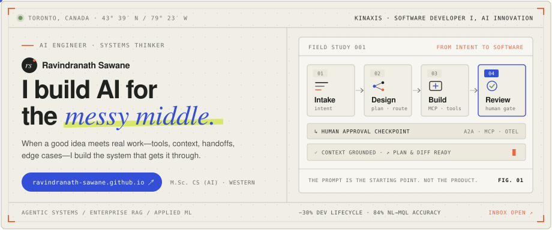
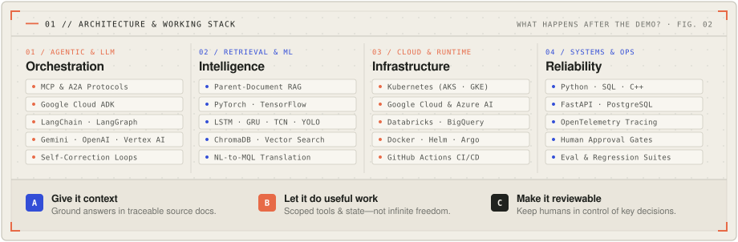
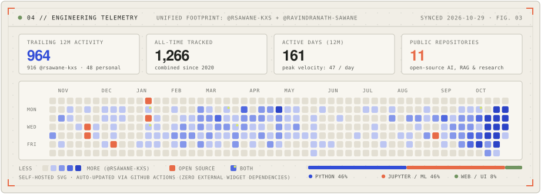

  <a href="https://ravindranath-sawane.github.io/">
    <picture>
      <source media="(prefers-color-scheme: dark)" srcset="./assets/hero-dark.svg">
      <source media="(prefers-color-scheme: light)" srcset="./assets/hero-light.svg">
      
    </picture>
  </a>

  <a href="https://ravindranath-sawane.github.io/"><b>Portfolio ↗</b></a>
  &nbsp;&nbsp;·&nbsp;&nbsp;
  <a href="https://github.com/rsawane-kxs"><b>Work GitHub (@rsawane-kxs) ↗</b></a>
  &nbsp;&nbsp;·&nbsp;&nbsp;
  <a href="https://www.linkedin.com/in/ravindranath-sawane/"><b>LinkedIn ↗</b></a>
  &nbsp;&nbsp;·&nbsp;&nbsp;
  <a href="https://scholar.google.ca/citations?user=m-A0ZYgAAAAJ&hl=en"><b>Google Scholar ↗</b></a>
  &nbsp;&nbsp;·&nbsp;&nbsp;
  <a href="mailto:ravisawane9@gmail.com"><b>ravisawane9@gmail.com ↗</b></a>

---

### `00 // CURRENT CHAPTER` — Where I’m Building Now

**Software Developer I, AI Innovation** at **[Kinaxis](https://www.kinaxis.com/)** *(Toronto, ON · Aug 2026 – Present)*

Building the production platform behind agentic AI for enterprise supply-chain engineering. My focus is designing dependable multi-agent systems that move work through **Intake → Design → Build → Review** with explicit human approval checkpoints—spanning secure **MCP** tool servers, **Agent-to-Agent (A2A)** coordination, cloud-native deployment on **Kubernetes (Azure AKS & Google GKE)** and **Databricks**, and end-to-end **OpenTelemetry** observability.

  <picture>
    <source media="(prefers-color-scheme: dark)" srcset="./assets/stack-dark.svg">
    <source media="(prefers-color-scheme: light)" srcset="./assets/stack-light.svg">
    
  </picture>

---

### `02 // THE WORKING SET` — Built Around Real Problems

#### Selected Systems & Field Studies · [Interactive Case Notes ↗](https://ravindranath-sawane.github.io/#work)

<table>
  <tr>
    <td width="50%" valign="top">
      <code>CASE 01 · DEVELOPER TOOLS · KINAXIS</code>
      <h4><a href="https://ravindranath-sawane.github.io/#work">KXS DevX — Agentic Engineering Framework</a></h4>
      
Moves software tasks through <b>Intake → Plan → Build → Review</b> around the actual workflows engineers use, keeping human code review in control.

      
<b>Impact:</b> 30% shorter development lifecycle &nbsp;·&nbsp; <b>Stack:</b> Agentic AI, Python, LangChain, GCP/Azure

    </td>
    <td width="50%" valign="top">
      <code>CASE 02 · ENTERPRISE KNOWLEDGE · KINAXIS MAESTRO</code>
      <h4><a href="https://ravindranath-sawane.github.io/#work">Kinara RAG — Source-Grounded Assistant</a></h4>
      
Enterprise RAG architecture using <b>Parent-Document Retrieval</b> and an agentic lifecycle so generated responses preserve broader context and cite traceable sources.

      
<b>Focus:</b> Context-preserving retrieval &nbsp;·&nbsp; <b>Stack:</b> LangChain, FastAPI, PostgreSQL, LLMs

    </td>
  </tr>
  <tr>
    <td width="50%" valign="top">
      <code>CASE 03 · MULTI-AGENT COORDINATION · GOOGLE CLOUD</code>
      <h4><a href="https://ravindranath-sawane.github.io/#work">JIRAXIS AI — Specialist Jira Agents</a></h4>
      
Stateful multi-agent assistant coordinating specialist sub-agents (Triage, Planner, Tool Execution, State) via explicit workflow state and tool calling.

      
<b>Architecture:</b> Specialist handoffs &nbsp;·&nbsp; <b>Stack:</b> Google Cloud ADK, Gemini 2.5 Pro, A2A, Python

    </td>
    <td width="50%" valign="top">
      <code>CASE 04 · APPLIED RESEARCH · WESTERN UNIVERSITY</code>
      <h4><a href="https://ravindranath-sawane.github.io/#work">Eyes on the Road — Gaze-Aware ADAS</a></h4>
      
M.Sc. thesis fusing driver gaze signals and custom object detection with sliding-window sequence models to anticipate lane-change and turn maneuvers.

      
<b>Data:</b> Ottawa &amp; London Driving Datasets &nbsp;·&nbsp; <b>Models:</b> LSTM, GRU, TCN, Custom YOLO

    </td>
  </tr>
</table>

#### Public Repositories & Open-Source Explorations

| Repository | Domain | Architecture & Highlights |
| :--- | :--- | :--- |
| **[`ChainSight-AI`](https://github.com/ravindranath-sawane/ChainSight-AI)** | Supply Chain Intelligence | Real-time financial & labor disruption monitor streaming events via **Google Cloud Pub/Sub → BigQuery → Gemini → Streamlit**. |
| **[`CreditCairn`](https://github.com/ravindranath-sawane/CreditCairn)** | Applied RAG Agent | Canadian credit rewards advisor powered by **Google Gemini**, **ChromaDB** semantic vector retrieval, and custom recommendation tools. |
| **[`Zero-To-GenAI`](https://github.com/ravindranath-sawane/Zero-To-GenAI)** | GenAI Curriculum | Hands-on engineering roadmap covering tokenization, prompting patterns, stateful agent memory, and **LCEL / ChromaDB** RAG pipelines. |
| **[`ravindranath-sawane.github.io`](https://github.com/ravindranath-sawane/ravindranath-sawane.github.io)** | Editorial Portfolio | Interactive field notes, process diagrams, and project studies — **[visit live site ↗](https://ravindranath-sawane.github.io/)**. |

---

### `03 // FROM RESEARCH TO PRODUCTION` — Experience & Education

| Timeline | Role & Institution | Key Outcomes |
| :--- | :--- | :--- |
| **Aug 2026 – Present** | **Software Developer I, AI Innovation** Kinaxis · Toronto, ON | Architecting the production agentic lifecycle platform (`Intake → Design → Build → Review`) across **AKS/GKE**, **Databricks**, **A2A + MCP**, and **OpenTelemetry**. |
| **Apr 2026 – Aug 2026** | **Software Developer I, AI Solutions** Kinaxis · Toronto, ON | Engineered multi-agent orchestration across Vertex AI & Azure AI, secure **MCP** tool integrations, and enterprise **NL-to-MQL** query pipelines. |
| **Sep 2025 – Apr 2026** | **Intern Developer, AI Solutions** Kinaxis · Toronto, ON | Raised natural-language-to-MQL translation accuracy to **84%** with **Gemini 2.5 Pro**; built self-correcting agent loops (>80% accuracy) for Kinaxis Maestro. |
| **Sep 2023 – Aug 2025** | **Graduate Research & Teaching Assistant** Western University · London, ON | **M.Sc. in Computer Science (AI)** *(3.9/4.0 GPA)*. Researched gaze-aware driver-maneuver prediction combining YOLO detection with LSTM, GRU & TCN models. |
| **Jul 2022 – Jul 2023** | **AI Research Assistant & MITACS Globalink Intern** IGDM Lab, University of Calgary | Built **ASTGCN** spatiotemporal graph traffic forecasters, geospatial visualizations, and parcel-delivery optimization (**B.Tech. in AI**, Nagpur University, *8.9/10*). |

  
<b>Publications, Honors &amp; Research Credentials</b> &nbsp;(5 publications · CAD $88,000 competitive funding · IEEE Merwin Scholar)

   

  **Selected Publications** ([Google Scholar ↗](https://scholar.google.ca/citations?user=m-A0ZYgAAAAJ&hl=en))
  - **Gaze-Aware Driver Maneuver Prediction Using Object Detection & Sequential Deep Learning for ADAS** — *M.Sc. Thesis, Western University (2025)*
  - **Incorporating Deep Q-Network with Multiclass Classification Algorithms** — *arXiv Preprint (2023)*
  - **A Real-Time Mobile-Net Approach for Mask Detection and Identity Identification System** — *IJECS (2022)* · [`MADIS Repo ↗`](https://github.com/ravindranath-sawane/MADIS_Mask-Detection-and-Identity-Identification-System)
  - **Comparison of Various Machine Learning Techniques Based on Variable Selection under Imbalanced Data** — *IJEDR (2022)*
  - **The Comparison of Supply Chain Management using Quantum Computing and Classical Computing** — *IJCRT (2022)*

  **Scholarships & Competitive Funding**
  - **CAD $88,000 Total Competitive Research Funding** — Western University Graduate Research Support & MITACS Globalink Research Award
  - **IEEE Computer Society Richard E. Merwin Scholarship** — Recognized internationally for academic excellence & student leadership

---

### `04 // ENGINEERING TELEMETRY` — Unified Activity

  <a href="https://github.com/rsawane-kxs">
    <picture>
      <source media="(prefers-color-scheme: dark)" srcset="./assets/telemetry-dark.svg">
      <source media="(prefers-color-scheme: light)" srcset="./assets/telemetry-light.svg">
      
    </picture>
  </a>

---

  <code>05 // THE NEXT QUESTION</code> 
  <b>Got a good problem?</b> I’m always up for thoughtful conversations about agentic AI, dependable software, and applied ML research.  
  <a href="mailto:ravisawane9@gmail.com"><code>ravisawane9@gmail.com</code></a> &nbsp;·&nbsp;
  <a href="https://ravindranath-sawane.github.io/"><code>ravindranath-sawane.github.io</code></a> &nbsp;·&nbsp;
  <a href="https://www.linkedin.com/in/ravindranath-sawane/"><code>linkedin.com/in/ravindranath-sawane</code></a>

